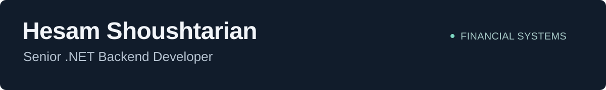

  

  <strong>Financial systems · Banking integrations · Investment platforms</strong> 
  C# · ASP.NET Core · Entity Framework Core · SQL Server · Redis

  <a href="https://www.linkedin.com/in/hesam-shoushtarian/">LinkedIn</a> ·
  <a href="#selected-professional-work">Professional work</a> ·
  <a href="#public-learning-projects">Public projects</a> ·
  <a href="#case-studies">Case studies</a>

## About me

I'm Hesam, a Senior .NET Backend Developer working on financial systems, banking integrations, and investment platforms. I focus on API design, domain modeling, data consistency, and services that are straightforward to maintain and troubleshoot.

At **SabaTech**, I work on token management, fund analytics, financial API simulation, and investment services. Previously, at **AVA Etminan**, I developed brokerage, supply chain finance, and corporate payment capabilities. I also independently delivered a booking and commerce platform backend and its administration panel.

I contribute through code review, mentoring, and collaboration with product, QA, frontend, and infrastructure teams. My earlier background in civil engineering and computational structural modeling informs how I approach complex systems.

## Selected professional work

| Area | My contribution |
| --- | --- |
| **Financial API simulation** | Built a simulation platform for financial, payment, identity, and SMS APIs with a React/TypeScript administration panel, supporting repeatable development and QA scenarios. |
| **Credentials and tokens** | Designed a central service for obtaining, reusing, renewing, and securely storing provider tokens, using persistent SQL storage and Redis caching. |
| **Investment analytics** | Developed fund return calculations and historical NAV processing, including validation of incomplete data and automated calculation tests. |
| **Banking and brokerage** | Developed banking integrations, electronic bill-of-exchange workflows, corporate payment capabilities, and accounting automation. |
| **Booking and commerce** | Independently delivered backend and administration features for bookings, orders, wallets, commissions, and inventory, with transaction controls and automated tests. |

These are summaries of professional experience. The public learning repositories below are separate projects.

## Case studies

| Project | What to explore |
| --- | --- |
| **Financial API Simulation Platform** | [View the case study on LinkedIn](https://www.linkedin.com/in/hesam-shoushtarian/overlay/1792921153916/single-media-viewer/?profileId=ACoAADPO0TcBXcJw4hNWozZffPdh_0NPFdfv3d4) — API simulation and the administration experience. |
| **SabaPay · First place, SabaTech Hackathon** | [View the collaborative project highlight](https://www.linkedin.com/in/hesam-shoushtarian/overlay/1792908003799/single-media-viewer/?profileId=ACoAADPO0TcBXcJw4hNWozZffPdh_0NPFdfv3d4) — merchant discovery and aggregation, developed collaboratively across frontend and backend in a two-person team. |

## Technical focus

| Backend & architecture | Data & reliability | Delivery & collaboration |
| --- | --- | --- |
| C# / .NET / ASP.NET Core | SQL Server / EF Core | Git / code review |
| REST APIs / API integration | Redis / distributed caching | xUnit / integration testing |
| Clean Architecture / DDD | Transactions / data validation | Troubleshooting / structured logging |
| CQRS / dependency injection | Authentication / authorization | Mentoring / technical documentation |

For administration panels and supporting web interfaces, I also work with **Razor Pages, React, TypeScript, Angular, and SignalR**.

## Public learning projects

The repositories in this section document hands-on learning. They are presented as educational projects rather than the source code of my professional systems.

| Repository | Focus | Structure to explore |
| --- | --- | --- |
| [**Mango Microservices**](https://github.com/s-hesam-s/Mango_Microservices) | .NET microservices and commerce workflows | Gateway, authentication, products, cart, orders, messaging, and rewards services. |
| [**MagicVilla API · Part 2**](https://github.com/s-hesam-s/MagicVilla_API-Part2) | ASP.NET Core Web API | API versioning, authentication and token handling, exception handling, and a web client. |
| [**Resort MVC**](https://github.com/s-hesam-s/Resort_MVC) | A layered ASP.NET Core application | Domain, Application, Infrastructure, and Web projects; booking, payment, and dashboard components. |

<strong>More learning repositories</strong>

- [Minimal API Coupon Demo](https://github.com/s-hesam-s/MinimalAPIDemo_Coupon) — a focused ASP.NET Core Minimal API exercise.
- [CodingWiki EF](https://github.com/s-hesam-s/CodingWiki_EF) — Entity Framework learning exercises.
- [Azure Fundamentals](https://github.com/s-hesam-s/AzureFundamentals) — Azure services and integration exercises.
- [MagicVilla API](https://github.com/s-hesam-s/MagicVilla_API) — the earlier API learning repository.
- [Bulky MVC](https://github.com/s-hesam-s/Bulky_MVC) — an ASP.NET Core MVC learning project.
- [Earlier frontend practice](https://github.com/s-hesam-s?tab=repositories&language=html) — HTML and web interface exercises.

## Connect

For my professional background and project highlights, visit [LinkedIn](https://www.linkedin.com/in/hesam-shoushtarian/).
