

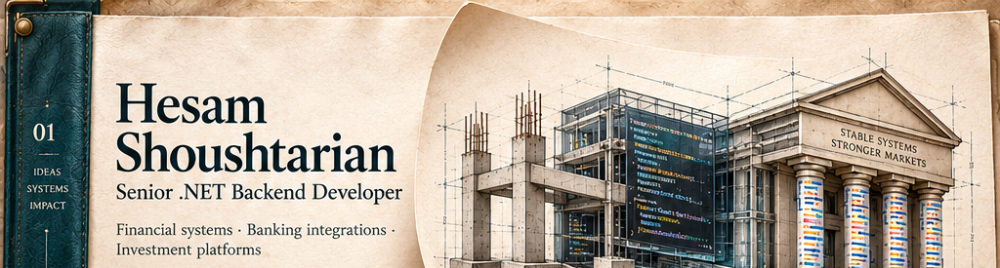 
<a href="#selected-work" title="Jump to selected systems">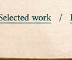</a><a href="#learning-archive" title="Jump to learning archive">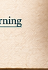</a> 
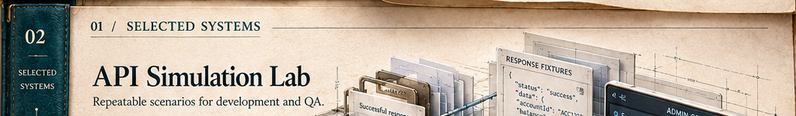 
<a href="https://www.linkedin.com/in/hesam-shoushtarian/overlay/1792921153916/single-media-viewer/?profileId=ACoAADPO0TcBXcJw4hNWozZffPdh_0NPFdfv3d4" title="API Simulation Lab — open case study">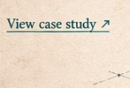</a> 
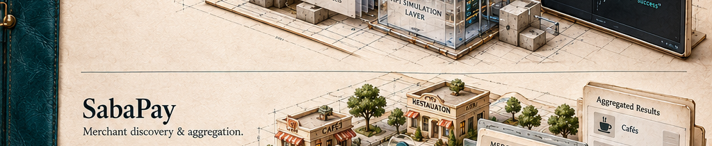 
<a href="https://www.linkedin.com/in/hesam-shoushtarian/overlay/1792908003799/single-media-viewer/?profileId=ACoAADPO0TcBXcJw4hNWozZffPdh_0NPFdfv3d4" title="SabaPay — open project highlight">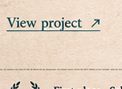</a> 
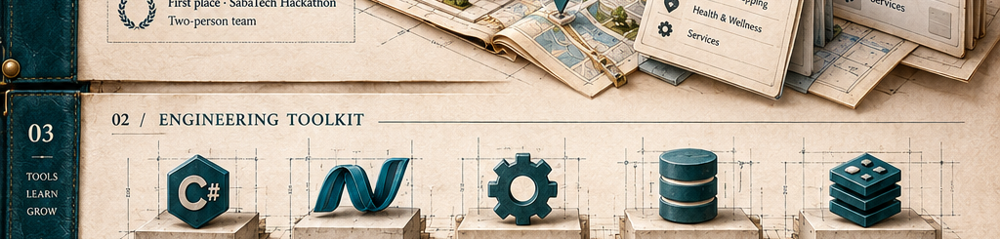 
 
<a href="https://github.com/s-hesam-s/Mango_Microservices" title="Mango Microservices">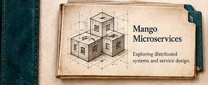</a><a href="https://github.com/s-hesam-s/MagicVilla_API-Part2" title="MagicVilla API Part 2">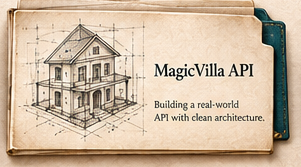</a><a href="https://github.com/s-hesam-s/Resort_MVC" title="Resort MVC">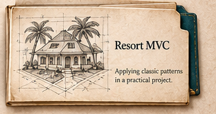</a> 
 

<picture></picture>

 
<a href="https://www.linkedin.com/in/hesam-shoushtarian/overlay/1792921153916/single-media-viewer/?profileId=ACoAADPO0TcBXcJw4hNWozZffPdh_0NPFdfv3d4" title="API Simulation Lab — open case study">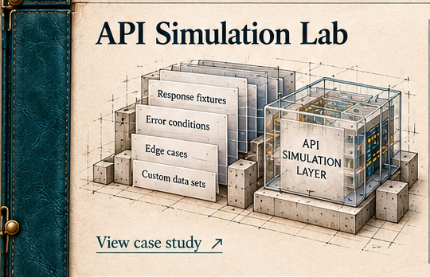</a><a href="https://www.linkedin.com/in/hesam-shoushtarian/overlay/1792908003799/single-media-viewer/?profileId=ACoAADPO0TcBXcJw4hNWozZffPdh_0NPFdfv3d4" title="SabaPay — open project highlight">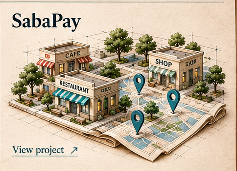</a> 
 
<a href="https://github.com/s-hesam-s/Mango_Microservices" title="Mango Microservices">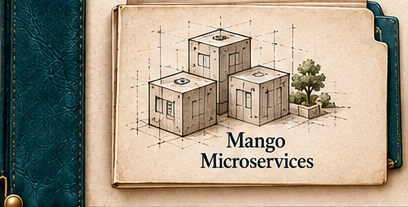</a><a href="https://github.com/s-hesam-s/MagicVilla_API-Part2" title="MagicVilla API Part 2">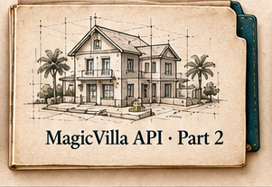</a><a href="https://github.com/s-hesam-s/Resort_MVC" title="Resort MVC">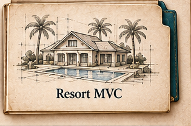</a> 
<a href="https://github.com/s-hesam-s/CodingWiki_EF" title="CodingWiki EF">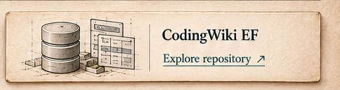</a> 
<a href="https://github.com/s-hesam-s/MagicVilla_API" title="MagicVilla API">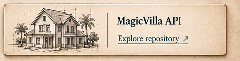</a> 
<a href="https://github.com/s-hesam-s/Bulky_MVC" title="Bulky MVC">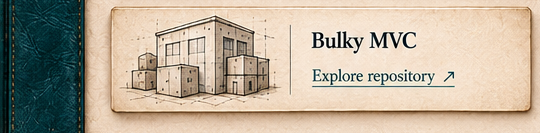</a><a href="https://github.com/s-hesam-s?tab=repositories&language=html" title="Frontend practice">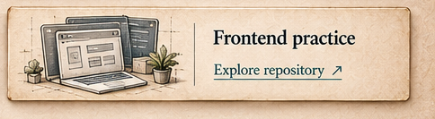</a> 
 

Read the complete professional notes

### Project links

- [LinkedIn — professional background & contact](https://www.linkedin.com/in/hesam-shoushtarian/)
- [API Simulation Lab — view case study](https://www.linkedin.com/in/hesam-shoushtarian/overlay/1792921153916/single-media-viewer/?profileId=ACoAADPO0TcBXcJw4hNWozZffPdh_0NPFdfv3d4)
- [SabaPay — view collaborative project highlight](https://www.linkedin.com/in/hesam-shoushtarian/overlay/1792908003799/single-media-viewer/?profileId=ACoAADPO0TcBXcJw4hNWozZffPdh_0NPFdfv3d4)

### Background & professional experience
I build financial systems, banking integrations, and investment platforms with .NET. My focus is API design, domain modeling, data consistency, and services that are straightforward to maintain and troubleshoot.

At **SabaTech**, I work on token management, fund analytics, financial API simulation, and investment services. Previously, at **AVA Etminan**, I developed brokerage, supply chain finance, and corporate payment capabilities. I also independently delivered a booking and commerce platform backend and its administration panel.

- **Financial API simulation** — Built a simulation platform for financial, payment, identity, and SMS APIs with a React/TypeScript administration panel, supporting repeatable development and QA scenarios.
- **Credentials and tokens** — Designed a central service for obtaining, reusing, renewing, and securely storing provider tokens, using persistent SQL storage and Redis caching.
- **Investment analytics** — Developed fund return calculations and historical NAV processing, including validation of incomplete data and automated calculation tests.
- **Banking and brokerage** — Developed banking integrations, electronic bill-of-exchange workflows, corporate payment capabilities, and accounting automation.
- **Booking and commerce** — Independently delivered backend and administration features for bookings, orders, wallets, commissions, and inventory, with transaction controls and automated tests.

I contribute through code review, mentoring, and collaboration with product, QA, frontend, and infrastructure teams. My earlier background in civil engineering and computational structural modeling informs how I approach complex systems.

The illustrations are visual interpretations of my work. The public learning repositories below are separate educational projects.

### Technical focus

C# · .NET · ASP.NET Core · EF Core · SQL Server · Redis

- **Backend & architecture:** REST APIs, API integration, Clean Architecture, DDD, CQRS, dependency injection.
- **Data & reliability:** Distributed caching, transactions, data validation, authentication, authorization.
- **Delivery & collaboration:** Git, code review, xUnit, integration testing, troubleshooting, structured logging, mentoring, technical documentation.
- **Supporting interfaces:** Razor Pages, React, TypeScript, Angular, SignalR.

### Learning archive

Hands-on educational projects, separate from my professional systems.

- [**Mango Microservices**](https://github.com/s-hesam-s/Mango_Microservices) — .NET microservices with gateway, authentication, products, cart, orders, messaging, and rewards services.
- [**MagicVilla API · Part 2**](https://github.com/s-hesam-s/MagicVilla_API-Part2) — ASP.NET Core Web API, versioning, authentication and token handling, exception handling, and a web client.
- [**Resort MVC**](https://github.com/s-hesam-s/Resort_MVC) — A layered application with Domain, Application, Infrastructure, and Web projects; booking, payment, and dashboard components.
- [Minimal API Coupon Demo](https://github.com/s-hesam-s/MinimalAPIDemo_Coupon) — a focused ASP.NET Core Minimal API exercise.
- [CodingWiki EF](https://github.com/s-hesam-s/CodingWiki_EF) — Entity Framework learning exercises.
- [Azure Fundamentals](https://github.com/s-hesam-s/AzureFundamentals) — Azure services and integration exercises.
- [MagicVilla API](https://github.com/s-hesam-s/MagicVilla_API) — the earlier API learning repository.
- [Bulky MVC](https://github.com/s-hesam-s/Bulky_MVC) — an ASP.NET Core MVC learning project.
- [Earlier frontend practice](https://github.com/s-hesam-s?tab=repositories&language=html) — HTML and web interface exercises.

