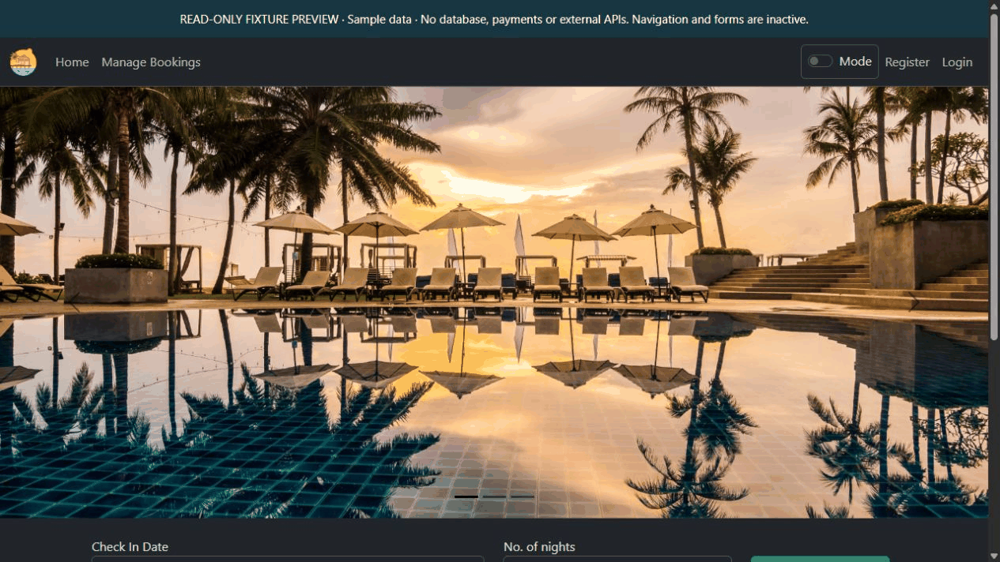
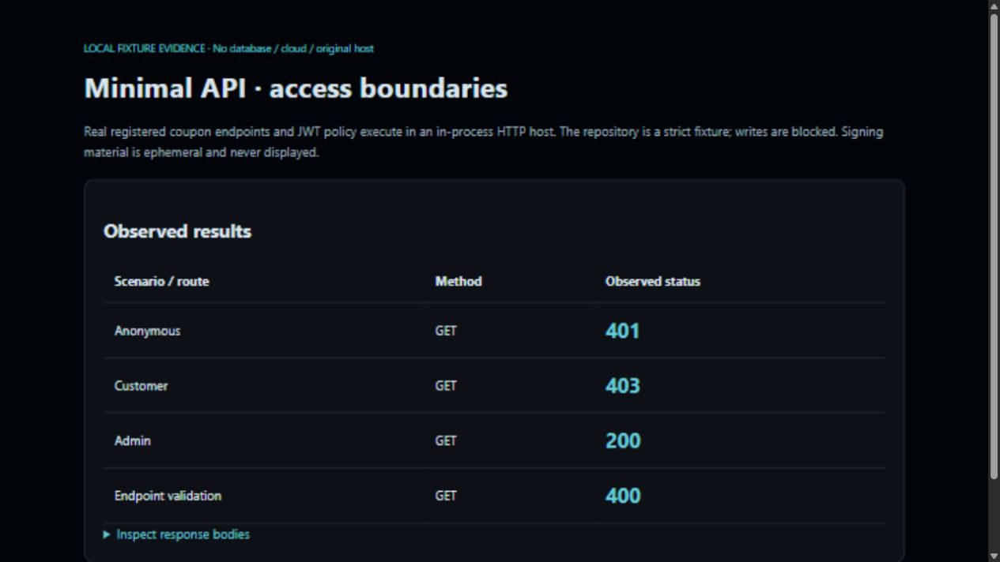
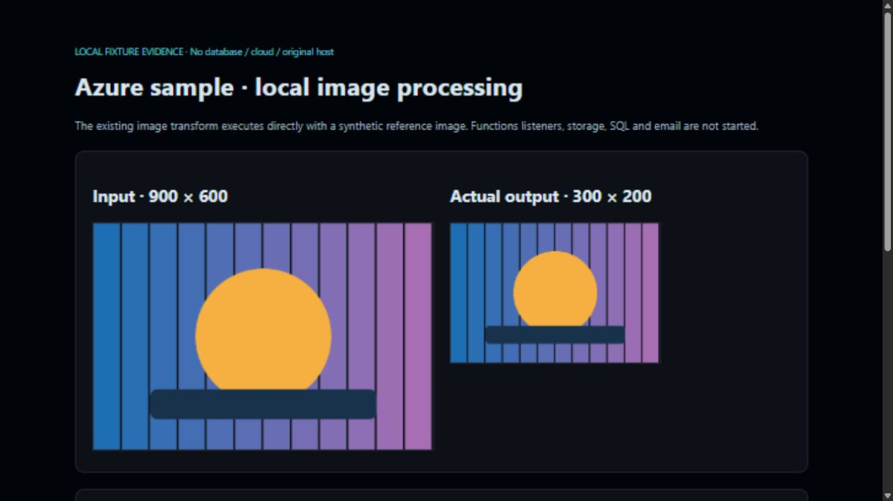
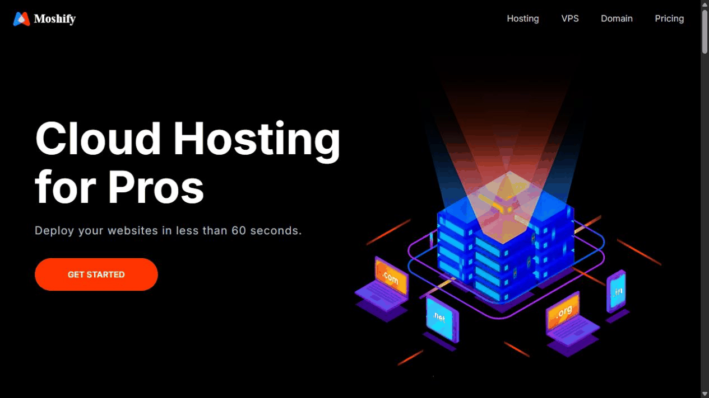
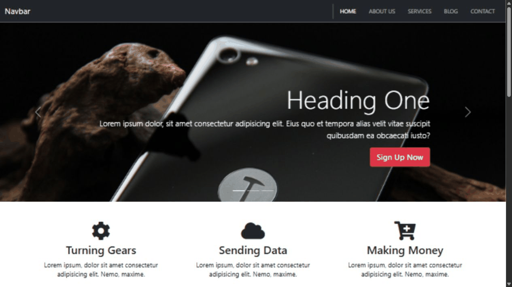
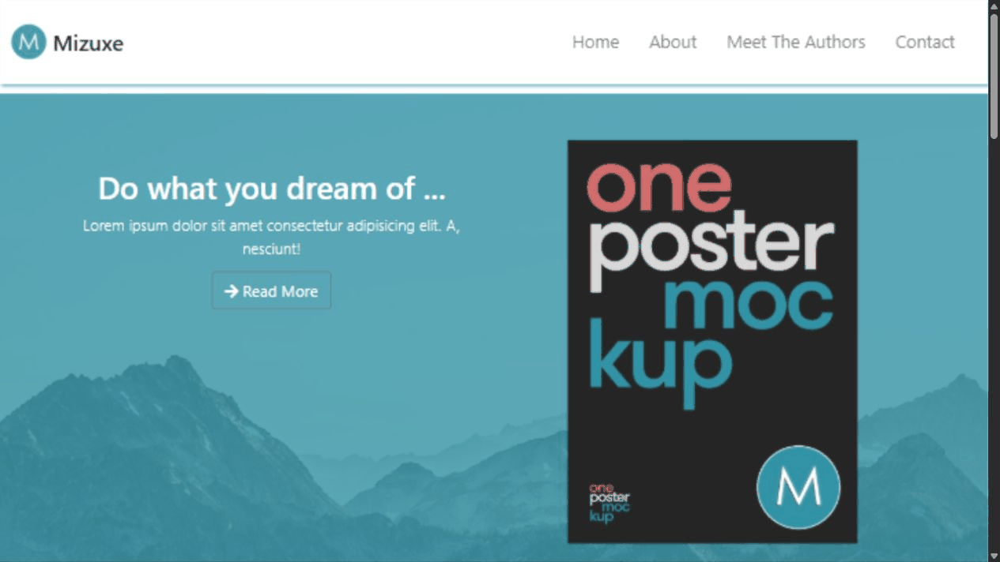
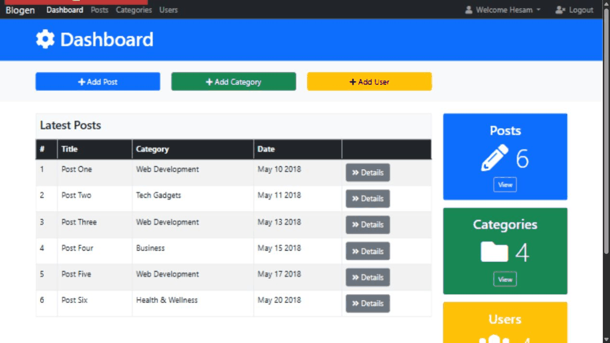
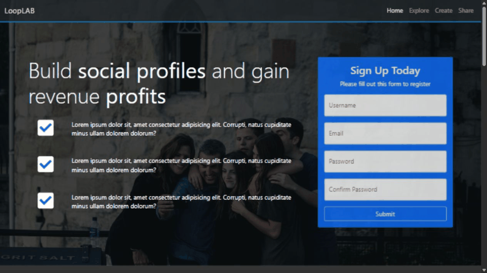
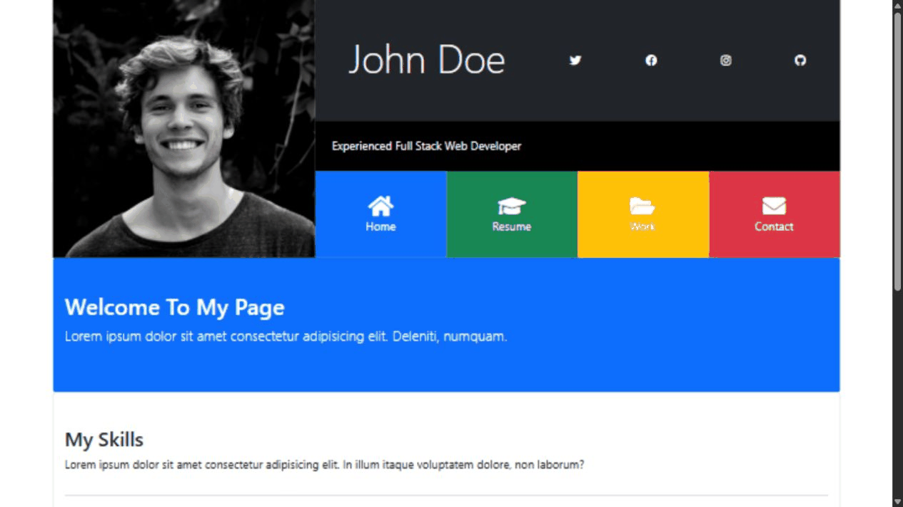

# Learning archive

Additional course-based repositories and early interface exercises. The two featured learning projects are in the [Project Atlas](README.md#selected-work). These captures show existing code with synthetic data or sample copy.

[Resort MVC](#resort-mvc-ui-tour) · [Bulky MVC](#bulky-preview) · [CodingWiki EF](#codingwiki-preview) · [Minimal API Coupon](#minimal-preview) · [MagicVilla · Early API](#early-magic-preview) · [Azure Fundamentals](#azure-preview) · [Frontend practice](#frontend-practice)

## Resort MVC · UI tour

<picture><source type="image/webp" srcset="assets/demos/resort-ui-tour.webp" /></picture>

Existing Razor views: carousel, villa cards and details modal with sample data. Captured UI states; no live reservation, database or payment transaction.

[Repository](https://github.com/s-hesam-s/Resort_MVC) · [Run the preview or open the static image](https://github.com/s-hesam-s/Resort_MVC/blob/master/docs/PREVIEW.md) · [Back to profile](README.md)

## Bulky MVC

<picture><source media="(prefers-reduced-motion: reduce)" srcset="assets/demos/bulky-portfolio-poster.png" /><source type="image/webp" srcset="assets/demos/bulky-portfolio.webp" /></picture>

Existing bookstore Razor views: catalog and product details, rendered with synthetic models. No cart, order or payment transaction.

[Repository](https://github.com/s-hesam-s/Bulky_MVC) · [Reproduce / static image](https://github.com/s-hesam-s/Bulky_MVC/blob/master/docs/PORTFOLIO-PREVIEW.md)

## CodingWiki EF

<picture><source media="(prefers-reduced-motion: reduce)" srcset="assets/demos/codingwiki-portfolio-poster.png" /><source type="image/webp" srcset="assets/demos/codingwiki-portfolio.webp" /></picture>

Existing book, book-detail and author views with sample relationships. No EF query, save or database operation.

[Repository](https://github.com/s-hesam-s/CodingWiki_EF) · [Reproduce / static image](https://github.com/s-hesam-s/CodingWiki_EF/blob/master/docs/PORTFOLIO-PREVIEW.md)

## Minimal API Coupon

Real coupon endpoints and JWT policies in an in-process HTTP fixture: anonymous 401, customer 403, admin 200 and invalid ID 400.

[Repository](https://github.com/s-hesam-s/MinimalAPIDemo_Coupon) · [Reproduce / static image](https://github.com/s-hesam-s/MinimalAPIDemo_Coupon/blob/master/docs/PORTFOLIO-PREVIEW.md)

## MagicVilla · Early API

The existing versioned Villa controller with a strict fixture repository: valid 200, invalid ID 400, missing 404 and sanitized repository failure 500.

[Repository](https://github.com/s-hesam-s/MagicVilla_API) · [Reproduce / static image](https://github.com/s-hesam-s/MagicVilla_API/blob/master/docs/PORTFOLIO-PREVIEW.md)

## Azure Fundamentals

The existing ImageThumbnail.Resize runs locally: PNG 900×600 to 300×200; TIFF and input over 8 MiB are rejected. No Functions host or cloud resource starts.

[Repository](https://github.com/s-hesam-s/AzureFundamentals) · [Reproduce / static image](https://github.com/s-hesam-s/AzureFundamentals/blob/master/docs/PORTFOLIO-PREVIEW.md)

## Frontend practice

Desktop and mobile views of six educational UI repositories. Sample names, prices and résumé entries are not professional claims.

## Hesamify

<picture><source media="(prefers-reduced-motion: reduce)" srcset="assets/demos/hesamify-portfolio-poster.png" /><source type="image/webp" srcset="assets/demos/hesamify-portfolio.webp" /></picture>

Hosting landing-page hero and pricing layout. Educational UI; search and purchase controls do not provision hosting.

[Repository](https://github.com/s-hesam-s/Hesamify) · [Reproduce / static image](https://github.com/s-hesam-s/Hesamify/blob/main/docs/PORTFOLIO-PREVIEW.md) · [Mobile capture](assets/demos/hesamify-portfolio-mobile.png)

## Glozzom

<picture><source media="(prefers-reduced-motion: reduce)" srcset="assets/demos/glozzom-portfolio-poster.png" /><source type="image/webp" srcset="assets/demos/glozzom-portfolio.webp" /></picture>

Business-site carousel and local photo gallery. Six broken remote gallery images now use assets already present in this repository.

[Repository](https://github.com/s-hesam-s/Glozzom) · [Reproduce / static image](https://github.com/s-hesam-s/Glozzom/blob/master/docs/PORTFOLIO-PREVIEW.md) · [Mobile capture](assets/demos/glozzom-portfolio-mobile.png)

## Mizuxe

<picture><source media="(prefers-reduced-motion: reduce)" srcset="assets/demos/mizuxe-portfolio-poster.png" /><source type="image/webp" srcset="assets/demos/mizuxe-portfolio.webp" /></picture>

Book landing page and the existing accordion interaction. Author names and content are educational sample copy.

[Repository](https://github.com/s-hesam-s/Mizuxe) · [Reproduce / static image](https://github.com/s-hesam-s/Mizuxe/blob/master/docs/PORTFOLIO-PREVIEW.md) · [Mobile capture](assets/demos/mizuxe-portfolio-mobile.png)

## Blogen

<picture><source media="(prefers-reduced-motion: reduce)" srcset="assets/demos/blogen-portfolio-poster.png" /><source type="image/webp" srcset="assets/demos/blogen-portfolio.webp" /></picture>

Static dashboard and category modal. Wide tables use the existing scrollable region on mobile. No authentication, post creation or persistence backend.

[Repository](https://github.com/s-hesam-s/Blogen) · [Reproduce / static image](https://github.com/s-hesam-s/Blogen/blob/master/docs/PORTFOLIO-PREVIEW.md) · [Mobile capture](assets/demos/blogen-portfolio-mobile.png)

## LoopLab

<picture><source media="(prefers-reduced-motion: reduce)" srcset="assets/demos/looplab-portfolio-poster.png" /><source type="image/webp" srcset="assets/demos/looplab-portfolio.webp" /></picture>

Landing page and anchor navigation to Explore. Forms are static UI examples; no account or message is submitted.

[Repository](https://github.com/s-hesam-s/LoopLab) · [Reproduce / static image](https://github.com/s-hesam-s/LoopLab/blob/master/docs/PORTFOLIO-PREVIEW.md) · [Mobile capture](assets/demos/looplab-portfolio-mobile.png)

## Portfoilogrid

<picture><source media="(prefers-reduced-motion: reduce)" srcset="assets/demos/portfoilogrid-portfolio-poster.png" /><source type="image/webp" srcset="assets/demos/portfoilogrid-portfolio.webp" /></picture>

Expandable Home, Resume and Work panels. John Doe and résumé entries are sample copy. Eight dead remote images were replaced with local SVG educational placeholders.

[Repository](https://github.com/s-hesam-s/Portfoilogrid) · [Reproduce / static image](https://github.com/s-hesam-s/Portfoilogrid/blob/master/docs/PORTFOLIO-PREVIEW.md) · [Mobile capture](assets/demos/portfoilogrid-portfolio-mobile.png)

[Back to profile](README.md)
