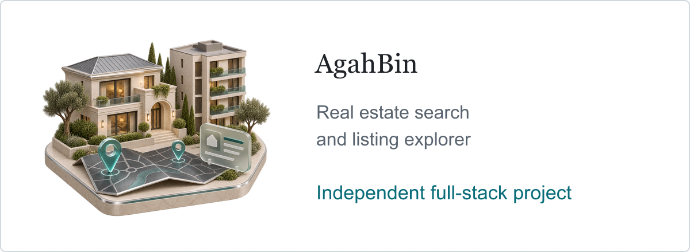

# AgahBin — Real Estate Search and Listing Explorer

<picture><source media="(max-width: 600px) and (prefers-color-scheme: dark)" srcset="../assets/v13/agahbin-type-mobile-dark.webp" /><source media="(max-width: 600px)" srcset="../assets/v13/agahbin-type-mobile-light.webp" /><source media="(prefers-color-scheme: dark)" srcset="../assets/v13/agahbin-type-dark.webp" /></picture>

**Independent full-stack project · Persian RTL interface**

AgahBin brings property search, a map, and listing details into one interface. It helps users narrow down apartments, houses, and land, inspect where a listing appears to be located, and keep track of properties and searches they want to revisit.

## Search and location matching

- Filter by city, property type, price, and listing attributes. Browse matching properties on an interactive map or in the results list.
- Check listing descriptions for location evidence. A result whose location cannot be confirmed stays distinguishable from a confirmed match.
- Save searches and favorites, review previously viewed listings, and open an individual listing for more detail.

## Backend

- ASP.NET Core API with separate real-estate and account modules. Background processing handles listing discovery and scheduled search execution.
- Entity Framework Core and SQL Server persist search runs, listings, and account data. A separate preview mode supports disposable local sessions.
- Account recovery uses a recovery code generated while signed in. The API applies filtering and location classification before presenting results.

## Frontend

- Next.js, React, and TypeScript, with shared API types and reusable interface components.
- MapLibre for map interaction. Mobile users can switch between dedicated map and list views without losing their place in the results.
- Persian RTL layout and mirror-silver light and dark themes.

## Verification and project status

GitHub CI runs backend tests, the frontend production build, and Markdown checks. The repositories are maintained separately and remain private. The project has been verified in local development and CI.

[Project directory](README.md) · [Back to profile](../README.md) · [LinkedIn projects](https://www.linkedin.com/in/hesam-shoushtarian/details/projects/)
