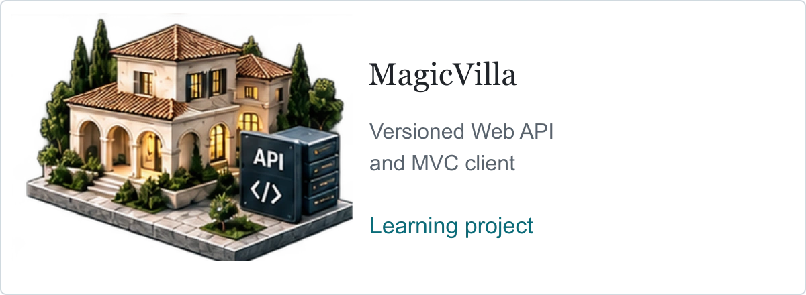

# MagicVilla — ASP.NET Core Web API Learning Project

<picture><source media="(max-width: 600px) and (prefers-color-scheme: dark)" srcset="../assets/v9/magicvilla-mobile-dark.webp" /><source media="(max-width: 600px)" srcset="../assets/v9/magicvilla-mobile-light.webp" /><source media="(prefers-color-scheme: dark)" srcset="../assets/v9/magicvilla-dark.webp" /></picture>

**Course-based learning project with personal extensions**

Developed and extended a course-based ASP.NET Core application for villa management, with a versioned Web API and an MVC client.

Implemented CRUD endpoints, filtering and pagination, role-based access, and access and refresh token workflows using ASP.NET Core Identity, Entity Framework Core, and SQL Server.

**Core technologies:** C#, ASP.NET Core, ASP.NET Core Identity, Entity Framework Core, SQL Server

[Repository](https://github.com/s-hesam-s/MagicVilla_API-Part2)

[Project directory](README.md) · [Back to profile](../README.md) · [LinkedIn projects](https://www.linkedin.com/in/hesam-shoushtarian/details/projects/)
