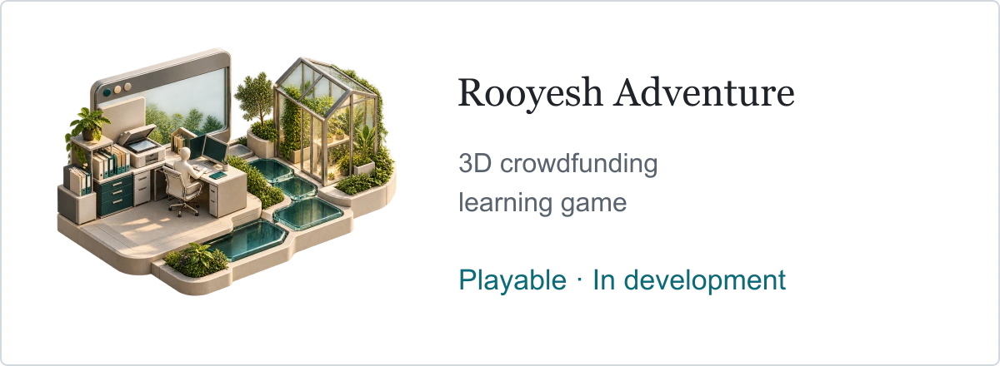
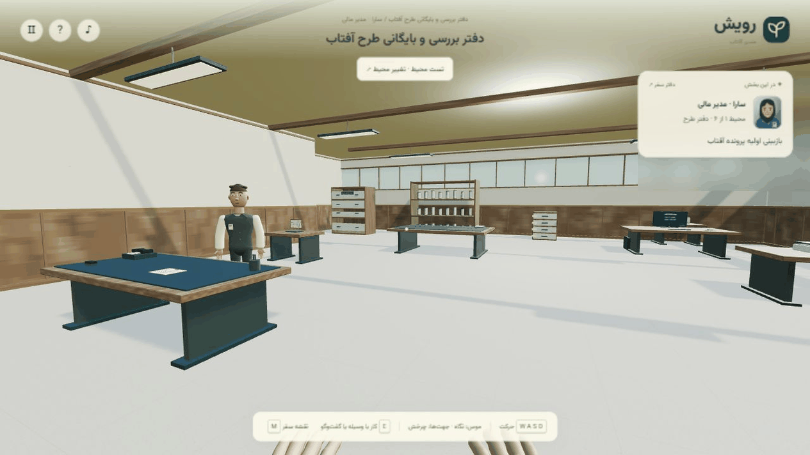

# Rooyesh — Path of the Sun

<picture><source media="(max-width: 600px) and (prefers-color-scheme: dark)" srcset="../assets/v10/rooyesh-mobile-dark.webp" /><source media="(max-width: 600px)" srcset="../assets/v10/rooyesh-mobile-light.webp" /><source media="(prefers-color-scheme: dark)" srcset="../assets/v10/rooyesh-dark.webp" /></picture>

**Independent educational game · Playable prototype in active development**

A Persian first-person 3D browser game that turns crowdfunding operations into a practical learning journey. Players explore workplaces, inspect documents and operate equipment while following the financing of a fictional greenhouse project.

The scenario connects four responsibilities: financial manager, issuer representative, individual investor and corporate investor. It makes the differences between payment, receipt validation, submission, reconciliation, approval and post-funding obligations visible through decisions and actions.

## Actual gameplay preview

<picture><source media="(prefers-reduced-motion: reduce)" srcset="../assets/demos/rooyesh-portfolio-poster.png" /><source type="image/webp" srcset="../assets/demos/rooyesh-portfolio.webp" /></picture>

Earlier first-office environment-test capture showing entry, movement and the journal. All six redesigned environments are now playable locally; this recording shows an earlier build.

[Local-play and capture notes](https://github.com/s-hesam-s/rooyesh-adventure/blob/main/docs/PORTFOLIO-PREVIEW.md) · [Static capture](../assets/demos/rooyesh-portfolio-poster.png)

## Engineering contribution

- Modelled financial rules, prerequisites and state transitions independently from scene rendering and interaction.
- Built a browser-based 3D experience with JavaScript ES modules, Three.js/WebGL, HTML/CSS and a Persian RTL interface.
- Implemented keyboard interaction, document handling, movement and collision, contextual dialogue and local progress persistence.
- Used scene caching, instancing, LOD and an adaptive rendering budget to manage runtime cost.
- Added automated regression coverage for domain progression, duplicate and invalid actions, replay/storage, movement and scene interactions.

## Current scope

The campaign contains ten chapters and twenty validated business decisions across six connected environments. All six redesigned environments are playable locally, with further visual polish and usability review ongoing.

- Review project terms, print and scan a reconciliation sheet, and check the permitted dates before issuer commitment.
- Calculate and register issuer receipts, assemble the dossier, reconcile submission responses and publish the project.
- Complete individual purchases through local fingerprint, bank-card and randomized OTP simulations, then reconcile bank and submission states separately.
- Verify corporate identity and representative authority, calculate remaining capacity, sign and submit documents and reconcile final approvals.
- Print and emboss the individual investor's certificate, exchange it physically and archive the signed acknowledgement.
- Register the profit schedule, advance the physical calendar device by three Persian months, reconcile only the first installment and keep three obligations open.

Equipment has state-dependent animation and document pickup, placement and filing. Character handoffs turn the receiver toward the player and transfer the point of view. Contextual guides are optional; keyboard interaction and close document inspection are supported. Independent test entries for six environments and the final courtyard keep the main saved journey separate.

The latest local verification on 2026-11-07 passed 444 Node.js tests and 40 Python maintenance tests. GitHub Actions also passed on Node.js 22 and 24. Browser review covered all environment entry points, the final office drawer and the ending; a full manual playthrough of every mission remains outstanding.

All identities, payments and external-system responses are synthetic and local. The game runs without live banking, payment or financial-market integrations. No measured educational outcomes or production adoption are claimed.

**Core technologies:** JavaScript, Three.js, WebGL, HTML, CSS, Node.js, glTF/PBR assets, Node.js test runner. Node.js serves local files; progress is stored in the browser.

**Artwork:** the portfolio illustration above is a conceptual representation, rather than an in-game screenshot. Runtime libraries and third-party assets retain their respective licenses and attribution.

[Repository and local-play instructions](https://github.com/s-hesam-s/rooyesh-adventure) · [Current office screenshot](https://github.com/s-hesam-s/rooyesh-adventure/blob/main/docs/office-current.png)

[Project directory](README.md) · [Back to profile](../README.md)
