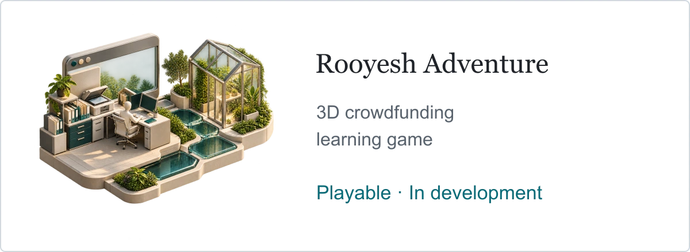

# Rooyesh — Path of the Sun

<picture><source media="(max-width: 600px) and (prefers-color-scheme: dark)" srcset="../assets/v10/rooyesh-mobile-dark.webp" /><source media="(max-width: 600px)" srcset="../assets/v10/rooyesh-mobile-light.webp" /><source media="(prefers-color-scheme: dark)" srcset="../assets/v10/rooyesh-dark.webp" /></picture>

**Independent educational game · Playable prototype in active development**

A Persian first-person 3D browser game that turns crowdfunding operations into a practical learning journey. Players explore workplaces, inspect documents and operate equipment while following the financing of a fictional greenhouse project.

The scenario connects four responsibilities: financial manager, issuer representative, individual investor and corporate investor. It makes the differences between payment, receipt validation, submission, reconciliation, approval and post-funding obligations visible through decisions and actions.

## Engineering contribution

- Modelled financial rules, prerequisites and state transitions independently from scene rendering and interaction.
- Built a browser-based 3D experience with JavaScript ES modules, Three.js/WebGL, HTML/CSS and a Persian RTL interface.
- Implemented keyboard interaction, document handling, movement and collision, contextual dialogue and local progress persistence.
- Used scene caching, instancing, LOD and an adaptive rendering budget to manage runtime cost.
- Added automated regression coverage for domain progression, duplicate and invalid actions, replay/storage, movement and scene interactions.

## Current scope

The campaign contains ten chapters and twenty business decisions. Its physical experience is being consolidated into six environments. The redesigned first office is playable; the full six-environment redesign remains in progress.

All identities, payments and external-system responses are synthetic and local. The game runs without live banking, payment or financial-market integrations. No measured educational outcomes or production adoption are claimed.

**Core technologies:** JavaScript, Three.js, WebGL, HTML, CSS, Node.js, glTF/PBR assets, Node.js test runner. Node.js serves local files; progress is stored in the browser.

**Artwork:** the portfolio illustration above is a conceptual representation, rather than an in-game screenshot. Runtime libraries and third-party assets retain their respective licenses and attribution.

[Repository and local-play instructions](https://github.com/s-hesam-s/rooyesh-adventure) · [Current office screenshot](https://github.com/s-hesam-s/rooyesh-adventure/blob/main/docs/office-current.png)

[Project directory](README.md) · [Back to profile](../README.md)
