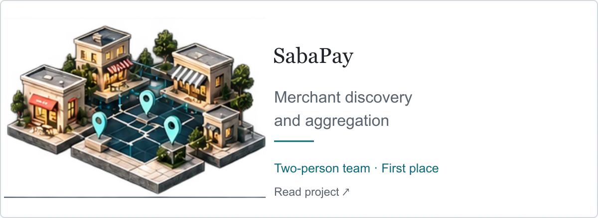

# SabaPay — Merchant Discovery and Aggregation Platform

<picture><source media="(max-width: 600px) and (prefers-color-scheme: dark)" srcset="../assets/v7/sabapay-mobile-dark.webp" /><source media="(max-width: 600px)" srcset="../assets/v7/sabapay-mobile-light.webp" /><source media="(prefers-color-scheme: dark)" srcset="../assets/v7/sabapay-dark.webp" /></picture>

**SabaTech · Two-person team · Hackathon first place**

Collaboratively developed a merchant discovery and aggregation platform as a two-person team at SabaTech, working together across the frontend and .NET backend. The project won first place in the SabaTech Hackathon.

The platform brings merchant information from multiple providers into a unified discovery experience, with search and filtering, interactive maps, branch details, coupons, ratings, and reviews.

Together, we developed the frontend using Next.js, React, and TypeScript, including a shared component library, typed API integration, and an administration dashboard for monitoring data synchronization. We also collaborated on the .NET backend for provider integration, data normalization, merchant matching and deduplication, and synchronization workflows.

Used assisted development throughout problem analysis, solution exploration, and implementation, while retaining responsibility for technical decisions, integration, and output review.

**Core technologies:** C#, .NET, ASP.NET Core, Entity Framework Core, PostgreSQL, Next.js, React, TypeScript, MapLibre

[Project highlight](https://www.linkedin.com/in/hesam-shoushtarian/overlay/1792908003799/single-media-viewer/?profileId=ACoAADPO0TcBXcJw4hNWozZffPdh_0NPFdfv3d4)

[Project directory](README.md) · [Back to profile](../README.md) · [LinkedIn projects](https://www.linkedin.com/in/hesam-shoushtarian/details/projects/)
